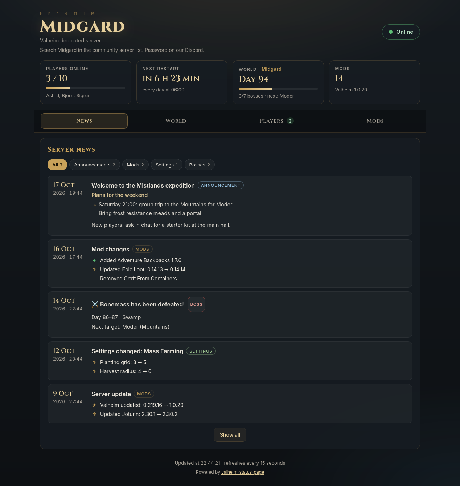

# valheim-status-page

A status page for Valheim dedicated servers running on [mbround18/valheim](https://github.com/mbround18/valheim-docker).
One small container, added next to your server, that shows your players what is going on, and can post the news to Discord.



## Features

- **Live status**: online/offline, players online and for how long, Valheim version.
- **Installed mods** with search, read from the BepInEx mod list.
- **Scheduled restart** countdown, with a warning banner when it is close.
- **Leaderboard**: play time, sessions, last seen and record of players online together.
- **Hall of Valhalla**: deaths read from the server log, recent falls, longest life, days in a row, and fun titles (most deaths, night owl, lone wolf, weekend warrior…).
- **World progression** *(experimental)*: in-game day, defeated bosses with the day they fell, milestones.
- **News feed**: mods added, removed or updated; mod settings that changed after a restart; bosses defeated; your own announcements.
- **Discord**: new entries posted to a channel through a webhook, with the Gale profile code to import after mod changes.
- **EpicLoot enchantments** *(optional, off by default)*: if your server runs EpicLoot, you can show every enchantment with its official description and the items it can roll on, with search and filters. Turn it on with `features.epicloot = true`.
- **World map**: embed your map (e.g. ValheimWebMap) if you have one. The [ServerSideMap](https://thunderstore.io/c/valheim/p/Mydayyy/ServerSideMap/) mod is recommended, so the explored areas are kept on the server and shared by all players.

Everything is read-only: the status page never changes your server's files.

## Requirements

- A server running the **mbround18/valheim** image, with its **Huginn** status server (it is built in, HTTP port 3000 by default).
  Huginn reports statistics only when the server is public (`PUBLIC=1`).
- Docker with Compose.
- Recommended for the world map: the [ServerSideMap](https://thunderstore.io/c/valheim/p/Mydayyy/ServerSideMap/) mod.
- Optional: BepInEx mods, Gale profile sync (`GALE_SYNC_CODE`), backups (`/home/steam/backups` mounted).

## Quick start

1. Add the `status-page` service to the `docker-compose.yml` of your server.
   See [docker-compose.example.yml](docker-compose.example.yml): mount the same folders as your `valheim` service, read-only.
2. Create the configuration folder and copy the examples:
   ```bash
   mkdir -p status-page/config status-page/data
   curl -o status-page/config/config.toml https://raw.githubusercontent.com/peppeaiello/valheim-status-page/main/config.example.toml
   ```
3. Start it:
   ```bash
   docker compose up -d --build status-page
   ```
4. Open `http://<your server>:8080`.

The first data appears within a minute. Play time is counted from the first run, and mod news starts from the second change, since the first run only records what is installed.

## Configuration

All options are documented in [config.example.toml](config.example.toml). The most common ones:

| Option | What it does |
|---|---|
| `server.huginn_url` | Huginn address, e.g. `http://valheim:3000` inside the same Docker network |
| `server.world` | World name; leave empty to auto-detect when there is only one |
| `page.title`, `page.subtitle`, `page.join_hint` | Texts at the top of the page |
| `page.map_url` | URL of a web map to embed |
| `features.*` | Turn each section on or off (the EpicLoot section is off unless you enable it) |
| `[[config_watch]]` | Mod settings to watch; changes are announced after the next restart |

Environment variables override the file: `HUGINN_URL`, `WORLD_NAME`, `DISCORD_WEBHOOK_URL`, `GALE_CODE`, `TZ`.

Set `TZ` to the same time zone as your `valheim` service, so the restart countdown matches the server's schedule.

### Announcements

Write your own news in `config/announcements.json` (see [announcements.example.json](announcements.example.json)). They appear in the feed and are posted to Discord.
The text supports a simple format: blocks separated by a blank line, a first line ending with `:` becomes the block title, and lines starting with `- ` become a list.

### Discord

1. In your Discord channel: *Edit channel → Integrations → Webhooks → New webhook*, copy the URL.
2. Set it as `DISCORD_WEBHOOK_URL` in the `status-page` service.

The webhook URL lets anyone post in your channel: keep it out of files you share. On the first run nothing is posted, so your channel is not flooded with old news. Messages never ping anyone.

## How it works

The container runs nginx and a small Python worker (standard library only). The worker reads Huginn and the mounted server folders, and writes JSON files that the page loads:

| File | Content | Refresh |
|---|---|---|
| `data/status.json` | status, players, mods, next restart | 10 s |
| `data/stats.json` | world progression, leaderboard | 1 min |
| `data/news.json` | news feed | 1 min |
| `data/hall.json` | Hall of Valhalla: deaths, titles, streaks | 1 min |
| `data/enchantments.json` | EpicLoot enchantments (only if enabled) | 6 h |

Its own state (play time, news, Discord history) is kept in `/data`.

### About the Hall of Valhalla

Deaths come from the server log, `logs/valheim_server.log` in the server folder (already mounted, nothing to add): Valheim writes `Got character ZDOID from <name> : 0:0` when a character dies. Deaths are counted from the start of the current log, so those older than the last server restart before the first run are not known. Play time by hour, weekend, alone or in a group is sampled from Huginn, in the time zone of the container (`TZ`). If your log is somewhere else, set `paths.server_log`; turn the section off with `features.hall = false`.

### About world progression

Valheim does not document its save format. The worker reads the chunked saves introduced with Valheim 1.0 (`worlds_local/<World>/_main.<N>.db2`): the in-game day and the global keys (`defeated_eikthyr`, ...). It works with Valheim 1.0.20, but a game update could change the format: in that case the section is hidden and everything else keeps working.

The save records *if* a boss was defeated, not *when*. The worker notices the key appearing between two saves, so the day is precise to one save (about one in-game day). Bosses defeated before the first run are dated from your backups when possible.

## Privacy

The page shows player names, when they were last seen, how long they played and how many times they died. Make sure your players are fine with it before making the page public.

## License

[MIT](LICENSE)
